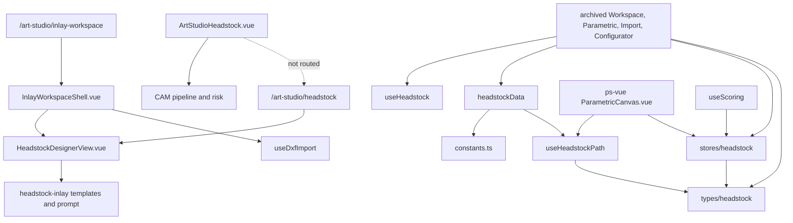

# Dependency graph

Measured at `4837c500`. Archived views are not routed. `git grep` of `packages/` and `services/` for `headstock/(Configurator|Import|Parametric|Workspace)View` finds no production importer.

## Recovered module to consumers

| Module | Recovered file | Consumers that name it | Resolution |
|---|---|---|---|
| `@/types/headstock` | `ps-vue-src/types/headstock.ts` | Store, path, scoring, constants, archived views, live `useDxfImport`, `useExportDxf`, `useCamSpec` | Direct recovery. Shape does not match the live composables. |
| `@/stores/headstock` | `ps-vue-src/stores/headstock.ts` | Archived views, `HeadstockSuite.vue`, `ParametricCanvas.vue`, `ScorePanel.vue`, `useScoring` | Direct recovery. Not imported from `packages/client/src`. |
| `@/assets/data/headstockData` | split: `constants.ts` and `useHeadstockPath.ts` | Archived Workspace, Parametric, Configurator; live `useExportDxf` wants `MM` | Reconstruction input. Adapter incomplete. |
| `@/composables/useParametric` | split: `useHeadstockPath.ts` and `useScoring.ts` | Live `useExportDxf` imports `buildTunerPositions` from `./useParametric` | Drop-in adapter infeasible. |
| `@/composables/useHeadstock` | none | Workspace, Parametric (`drawBackground` only), Configurator | Not recovered. |
| `@/composables/useKonvaCanvas` | live file, and a different file in `ps-vue-src` | Neck and inlay views use the live file. Archived views and `ParametricCanvas.vue` expect two different signatures. | Live and recovered. Neither is the missing draw module. |
| `@/composables/useDxfImport` | live, and a copy in `ps-vue-src` | Routed `InlayWorkspaceShell.vue` calls `loadFile` | Reachable. Types and the spline route are broken. |
| `@/composables/useExportDxf` | live only | No runtime caller under `packages/client/src` | Present, not reachable from a route. |
| `useCamSpec` | `design-utilities/lutherie/neck/useCamSpec.ts` | Re-exported from `neck/index.ts`. `CamSpecPanel.vue` imports the type from `@/composables/useCamSpec`, a path that does not exist. No `useCamSpec(` call outside the definition. | Present, not reachable. |
| `useWoodGrain` | `packages/client/src/composables/useWoodGrain.ts` | `InlayWorkspaceShell.vue` | Live, on the inlay route. The suite's `WoodGrainPanel.vue` is archive-only. |
| `@/stores/variants`, `VariantLibraryPanel.vue`, `WoodGrainPanel.vue` | `docs/archive/photo_vectorizer_patches/` | Archived Workspace only | Archive only. Not in `ps-vue-src`. |

## Reachability of the three named composables

| Symbol | Runtime caller in `packages/client/src` | Routed |
|---|---|---|
| `useDxfImport` | `InlayWorkspaceShell.vue` calls `loadFile` | Yes. `/art-studio/inlay-workspace` |
| `useExportDxf` | none | No |
| `useCamSpec` | none. Comments in both `CamSpecPanel.vue` files show a sample call. They are comments. | No |

`HeadstockDesignerView.vue` does not import any of the three.
